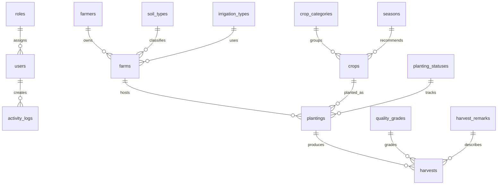

# DataCorePoint Agriculture Information System

## Project overview

DataCorePoint is a PHP web application for recording farmers, farms, crops, plantings, and harvests. It uses Supabase PostgreSQL for application data and provides a dashboard, searchable records, role-controlled account management, archived-record restoration, and operational reports.

## Objectives

- Keep related agriculture records in one database-backed application.
- Connect farmers, farms, crops, plantings, and harvests through database keys.
- Give authorized users a clear view of current operations and harvest results.
- Keep deleted operational records recoverable through soft archiving.

## Functional guide

1. Sign in with an account in the `users` table. Passwords are checked with PHP password hashing; a legacy plain-text password is upgraded after its next successful sign-in.
2. The dashboard shows live counts, harvested quantity, plantings by status, harvests by grade, recent records, and links to the main modules.
3. Add farmers before farms. A farm belongs to a farmer. Add crops before creating plantings. A planting connects one farm, one crop, and one planting status.
4. Record a harvest against a planting. Select its quality grade and standard remark from lookup lists.
5. Search and filter records in the module pages. Lists update as the user types; harvests can also be filtered by grade and paged.
6. Archive actions move records out of active lists without permanently deleting them. An administrator can restore them from Archived Records.
7. Administrators can create and edit accounts and assign roles in User Management. Accounts with activity history cannot be deleted because activity logs reference the user.
8. The notification bell shows recent activity. Administrators can review and search all account actions in Activity Logs; staff only see their own recent actions in the notification list.
9. Logging out opens a confirmation screen. After confirming, the app records the logout and shows a thank-you page.
10. Reports can be filtered by a date range and printed from the browser.

## Entity relationship overview

The supplied Supabase ERD screenshot and an editable Mermaid diagram are in [docs/ERD.md](docs/ERD.md).

`system_settings` stores application setting key/value records. Primary and foreign keys should be confirmed in the Supabase Table Editor when preparing the final submission.

## Main table dictionary

| Table | Purpose | Key relationships |
| --- | --- | --- |
| `farmers` | Farmer names, contact, address, registration date, archive flag | Parent of `farms` |
| `farms` | Farm name, location, area, soil, irrigation, archive flag | Farmer, soil, and irrigation references |
| `crops` | Crop name, variety, category, growing period, season | Category and season references |
| `plantings` | Dates, area, seed quantity, status, archive flag | Farm, crop, and planting status references |
| `harvests` | Harvest date, quantity, price, grade, remark, archive flag | Planting, quality grade, and harvest remark references |
| `roles` / `users` | Account names, password hashes, role assignment | User role; activity log actor |
| `activity_logs` | User actions and timestamps | References `users` |
| `soil_types`, `irrigation_types` | Farm dropdown options | Referenced by `farms` |
| `crop_categories`, `seasons` | Crop dropdown options | Referenced by `crops` |
| `planting_statuses` | Planting status dropdown options | Referenced by `plantings` |
| `quality_grades`, `harvest_remarks` | Harvest dropdown options | Referenced by `harvests` |
| `system_settings` | Application settings | Key/value settings |

## Normalization status

The live schema uses separate lookup tables and numeric foreign keys for soil, irrigation, crop category, season, planting status, quality grade, and harvest remarks. The normalization migration has been applied; the live audit found no remaining duplicate legacy label columns and no missing required lookup IDs. The application displays lookup labels and stores their IDs.

A live audit on 2026-11-06 confirmed the normalization migration is in place. No additional lookup-label migration is currently required. See [the normalization review](docs/NORMALIZATION_REVIEW.md) and regenerate the [live data dictionary](docs/DATA_DICTIONARY.md) before submission.

## Configuration and deployment

- `includes/db.php` reads `SUPABASE_DB_HOST`, `SUPABASE_DB_PORT`, `SUPABASE_DB_NAME`, `SUPABASE_DB_USER`, and `SUPABASE_DB_PASSWORD` from the environment.
- For local XAMPP, the ignored `includes/db.local.php` holds local-only settings. `includes/db.local.php.example` shows the expected shape. Never commit the local file.
- The `includes` directory denies direct HTTP requests through its `.htaccess` file.
- Reset the database password in Supabase if it has been shared outside your local configuration, then update the local config or deployment environment.

## Verification performed

- PHP syntax checks passed for project PHP files and the local database config.
- A read-only query confirmed the configured Supabase connection.
- Dashboard, reports, harvests, user management, and archived-record pages rendered with authenticated read-only sessions and no PHP warnings.
- Farmer, farm, crop, planting, and harvest live-search endpoints returned table output with no PHP warnings.
- No create, update, archive, restore, or delete operation was submitted during these checks.

Before submission, also test create/edit/archive/restore using disposable records, test invalid form values and role restrictions, and capture screenshots of the running system. Those write-flow tests and screenshots are not included in this verification.

## Documentation still to complete for submission

- Attach screenshots of the working login, dashboard, modules, and reports.
- Confirm actual database constraints and document each column's type, nullability, defaults, and foreign key.
- Complete a formal unnormalized-to-3NF normalization walkthrough after the database migration is designed.
- Run and record create/update/archive/restore and invalid-input tests using disposable data.
