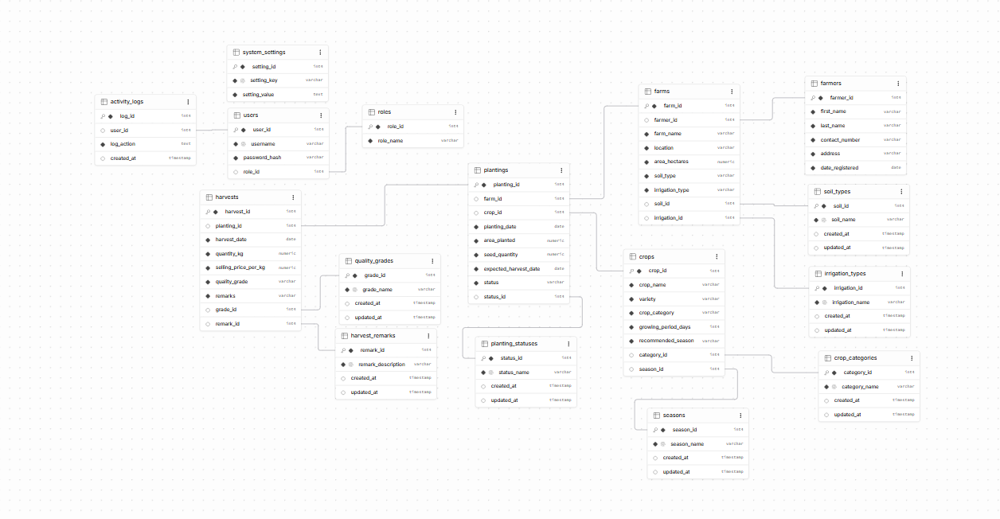
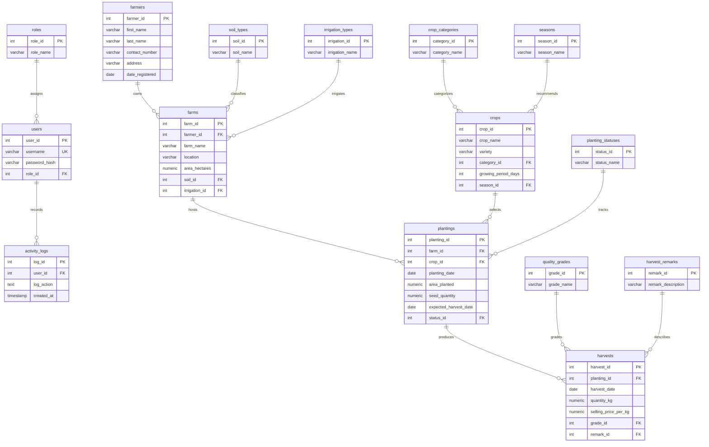

# Agriculture Information System ERD

This diagram is based on the normalized Supabase schema screenshot supplied in the normalization DOCX. The embedded screenshot is the source ERD captured from Supabase; the Mermaid diagram below is an editable text version for GitHub and future updates.

`system_settings` is a key/value configuration table and is not connected to the operational records.

## Lookup behavior in the application

Forms display the descriptive lookup labels and submit their numeric IDs. For example, a harvest remark selection submits `remark_id`; the readable label is obtained by joining `harvest_remarks`. The current database also retains old descriptive columns such as `harvests.remarks` as `NOT NULL`. New application writes leave those legacy text fields empty and use the IDs. Older records may still contain text in those columns.

## Schema caveat

The lookup-normalization migration has been applied in Supabase. A live catalog audit found the duplicate label columns removed and required lookup IDs populated. The diagram remains a design aid; confirm it against the latest generated data dictionary before using it as the final schema contract.
